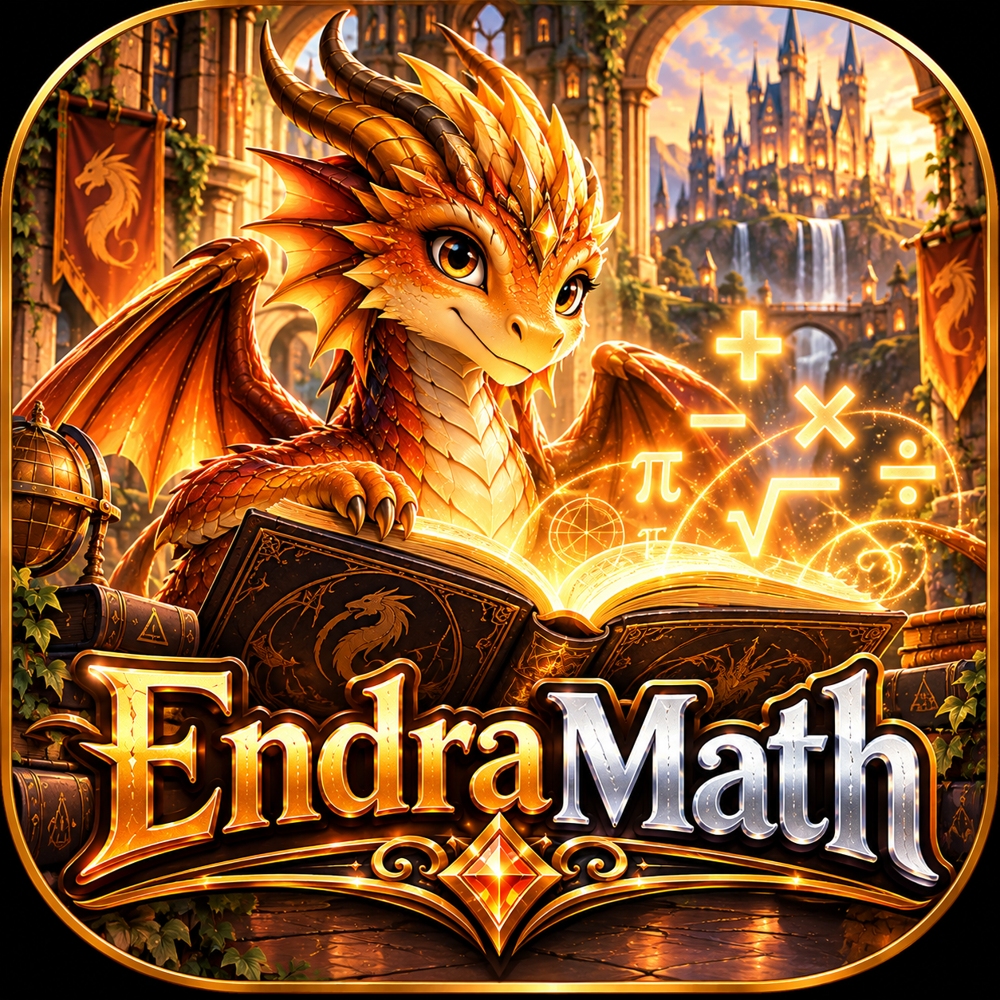

# 🐉 EndraMath

**A magical place to learn mathematics — at your own pace.**

*Pre-K foundations through college-level mathematics.*

## Our promise

EndraMath is built to encourage learning, **never to label or shame learners**. No child-facing grade-level judgments, comparisons, speed penalties, or negative placement labels. Every learner deserves a welcoming place to begin.

## Learning experience

- **Learn → Guided Practice → Independent Practice → Final Quiz → Review.**
- Optional hints, worked examples, formula help, explanations, and a question-linked whiteboard.
- **“Where Should I Start?”** offers adaptive, supportive placement and recommends topics, not grade levels.
- Skills unlock through transparent prerequisites and demonstrated understanding. Learners can challenge prerequisites without repeating years of lessons.
- Unlimited practice, no timed pressure, and achievements that never disappear.
- Multiple independent learner profiles and automatic local-first progress saving.

## Curriculum

The long-term curriculum spans twelve academies: Early Number, Arithmetic, Fractions & Measurement, Pre-Algebra, Algebra, Geometry, Trigonometry, Data & Statistics, Probability, Precalculus, Calculus, and College Extensions. Academies are **not** rigid grade levels. Spanish number words and Roman numerals are optional enrichment.

## Dragon companions

Dragon companions are optional. Two free starter breeds, **Solaris** and **Aurora**, are planned, with seven basic accent-color choices. Growth reflects unique verified mastery, never speed, repetition, or purchases. All academic content stays available without Premium or dragons. Cosmetic options may be offered later.

## Visual identity

The approved direction is a warm **orange, amber, bronze, and gold** magical academy with castles, waterfalls, books, and a welcoming orange dragon mascot. Preserve approved artwork and layouts; do not silently redesign them.

## First prototype scope

1. Approved homepage/navigation and learner profiles.
2. Initial Early Number and Arithmetic lessons with teaching, practice, and explanations.
3. Adaptive placement prototype, prerequisite checks, and independent mastery quizzes.
4. Whiteboard, optional dragon selection, and basic achievement tracking.
5. Local progress persistence, accessibility, and phone/tablet verification.

The placement prototype assesses only implemented skills. The full Pre-K–college library, advanced tools, Premium cosmetics, and cloud synchronization are later milestones. **Teacher portal, classroom tools, standards, and teacher reports are out of the initial build.**

## Project status

**Planning / repository setup.** This README describes the intended product, not completed features. No tested APK is available yet.

## Development principles

- Keep approved visual designs intact unless explicitly changed.
- Preserve learner data through upgrades and optional feature changes.
- Validate mathematics, accessibility, and small-screen layouts before declaring a build ready.
- Make progress through small, testable checkpoints.
